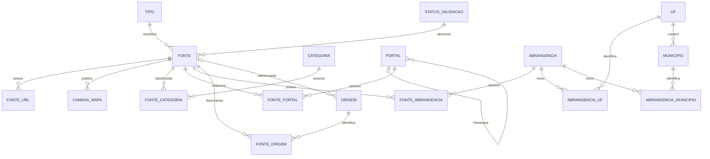

# Catálogo relacional OSINT Rondônia

## Interface de exploração

O site em `web/` é gerado pelo SvelteKit em arquivos estáticos. SvelteKit prerenderiza as rotas de navegação, e a interface executa as buscas no navegador com uma cópia do SQLite. O Web Worker abre o banco uma vez, ativa `query_only` e executa operações com valores parametrizados. A URL do banco contém seu SHA-256, então uma atualização do SQLite gera um caminho de asset novo. O seletor de imagens de satélite também consulta o SQLite: `camada_mapa` guarda produtos renderizáveis e liga cada camada à ficha `fonte` que a publica.

A tela reúne mapa, contadores e uma tabela de fontes e ferramentas. A busca por nome ou descrição, os filtros nos cabeçalhos e a seleção territorial atualizam a tabela e os contadores na mesma consulta. Os links temáticos abrem essa tela com combinações de categorias por união (`anyOf`), interseção (`allOf`) e exclusão (`noneOf`). A ordenação inicial usa nome com desempate pelo ID, em páginas de 25 fichas.

O filtro de UF procura UFs vinculadas à cobertura e municípios localizados nela, contando cada ficha uma vez. Fichas cuja abrangência tem a flag `nacional` entram automaticamente em cada recorte específico de UF ou município; não há uma opção separada para incluí-las. A regra usa a abrangência declarada, sem inferir alcance nacional pelo campo `esfera`. A localidade declarada aparece na ficha da fonte, sem se somar à cobertura. As contagens de categorias e UFs podem sobrepor fichas e as tabelas acessíveis mostram os mesmos grupos dos gráficos.

As fichas mostram categorias, proveniência e responsáveis com links para os registros associados. A interface apresenta triagem, validação e situação declarada das URLs em campos separados. Só endereços HTTP e HTTPS viram links externos.

## Desenvolvimento da interface

Os comandos abaixo instalam, verificam, testam e compilam dependências e código em contêineres. Node.js e pnpm têm versão fixa no Dockerfile. O lockfile mantém as dependências resolvidas; não instale dependências diretamente na máquina host.

```bash
# Abrir o ambiente de desenvolvimento em http://localhost:5173
just web-dev

# Verificar formatação, tipos e consultas ao SQLite
just web-check

# Rodar o gate completo do catálogo e do site
just check

# Gerar os arquivos estáticos para GitHub Pages
just web-build
```

`just web-build` coloca o artefato em `.local/site`, configurado sob o caminho `/osint-rondonia/`. O workflow de publicação baixa a revisão aprovada pelo gate, executa a mesma receita e publica o artefato com GitHub Pages. A primeira implantação depende de habilitar GitHub Pages com origem GitHub Actions nas configurações do repositório.

## Arquitetura

O Data Package v2 publica os CSV sob `data/`. A tabela `fonte` reúne 5.025 fichas, incluindo 391 fontes identificadas nos inventários históricos. Essas novas fichas têm triagem pendente. As sete referências do antigo TODO e a ficha do Atlas da Imprensa também têm triagem pendente. A hierarquia atual contém 3.720 portais: 3 grupos, 736 instituições e 2.981 sites. Há 1.371 relações de subportal e 2.349 nós-raiz; muitos portais permanecem na raiz quando não há relação superior confirmada. As 6.065 ligações incluem 5.009 publicadores, 1.024 órgãos responsáveis e 32 entidades responsáveis. Vinte e oito fichas não têm portal porque não possuem domínio interpretável nem responsabilidade declarada; não foi inferido um vínculo para elas.

Os caminhos e hashes dos 4.571 JSON individuais continuam disponíveis no [CSV histórico do commit `12f926c`](https://github.com/Rondoscopio/osint-rondonia/blob/12f926c3052bf84804c30fc8851761eb6f7f8373/data/registro_original.csv). Para as novas fichas extraídas dos inventários, o caminho do documento está em `origem.valor_original`, ligado à ficha por `fonte_origem` com `tipo_origem=origem_cadastro`.

Os [CSV históricos](https://github.com/Rondoscopio/osint-rondonia/tree/89b07610b3e5f4906f5278edfb15f8a0d29dd601/data) continuam recuperáveis no commit `89b0761`. Dos 7.749 itens, 5.551 já apontavam para fichas, 391 originaram fichas e 13 foram associados a fichas por referência ou por nome e endereço. As 22 tarefas foram para o README e 1.772 itens ficaram apenas no histórico. A revisão histórica conserva também a composição original dos inventários, a ordem, os metadados e os campos que ficaram sem representação no catálogo ativo.

## Filtrar fontes por categoria no SQLite

Em `categoria`, cada rótulo representa um tema. Por exemplo, fichas classificadas como “Contratos e Licitações” passam a ter os dois temas separados. Expressões de sentido próprio, como “Dados Abertos” e “Processo Eletrônico (PJe 1º e 2º Grau)”, ficam juntas. As combinações temáticas ficam no front-end e consultam `fonte_categoria` por IDs: podem unir temas, exigir todos, excluir temas ou combinar essas operações. As definições atuais estão em `web/src/lib/shared/recuts.ts`; não criam uma entidade ou conjunto de fichas duplicado.

Na tabela `categoria`, localize o `id` pelo campo `nome` e confira o `tipo_classificacao`. Vincule esse ID ao parâmetro `:categoria_id` no cliente SQLite.

```sql
SELECT f.id, f.nome, f.descricao
FROM fonte AS f
JOIN fonte_categoria AS fc ON fc.fonte_id = f.id
WHERE fc.categoria_id = :categoria_id
ORDER BY f.nome, f.id;
```

A consulta retorna uma linha por ficha associada à categoria escolhida. Fichas sem categoria continuam disponíveis em `fonte`. Para interseções, acrescente uma condição `EXISTS` por cada ID exigido; para exclusão, use `NOT EXISTS` com os IDs que devem ficar de fora. A interface implementa essas combinações sem uma tabela `lista`.

## Portais e hierarquia institucional

`portal` é uma hierarquia recursiva de nós reutilizáveis, não uma cópia das fichas. `tipo` distingue grupos de organização, instituições responsáveis e sites publicadores. `portal_pai_id` aponta para outro registro da própria tabela, permitindo níveis como grupo → instituição → site ou portal. `fonte_portal` liga várias fichas a qualquer nó e registra o papel da relação (`publicador`, `orgao_responsavel` ou `entidade_responsavel`). Uma fonte também pode apontar para mais de um portal.

Os nós de instituição preservam o texto declarado nos campos de responsabilidade. Os nós de site são agrupados por origem web, sem modificar nenhuma URL de `fonte_url`. Quando uma esfera única está declarada nas fontes de uma instituição, ela é agrupada sob o nó federal, estadual ou municipal correspondente. Um site é colocado sob uma instituição somente quando as fichas ligadas ao domínio apontam para uma única instituição responsável; nos demais casos, permanece sem esse vínculo inferido. A hierarquia pode ser corrigida diretamente em `portal_pai_id`, mantendo IDs persistentes e sem mesclar nomes semelhantes automaticamente.

Na ficha, o link de um portal abre a tabela filtrada pelas relações diretas daquele nó. As fichas vinculadas aos descendentes podem ser consultadas na hierarquia do SQLite.

## Filtrar fontes por UF no SQLite

Use o código IBGE da UF em `:codigo_uf`. A consulta inclui a própria UF, seus municípios e automaticamente as fichas com abrangência nacional. A localização declarada da ficha pode ser consultada separadamente pelo papel `localidade_declarada`.

```sql
SELECT f.id, f.nome
FROM fonte AS f
JOIN fonte_abrangencia AS fa ON fa.fonte_id = f.id
JOIN abrangencia AS a ON a.id = fa.abrangencia_id
WHERE fa.papel = 'cobertura'
  AND (
    EXISTS (
      SELECT 1 FROM abrangencia_uf AS au
      WHERE au.abrangencia_id = a.id AND au.uf_codigo_ibge = :codigo_uf
    )
    OR EXISTS (
      SELECT 1 FROM abrangencia_municipio AS am
      JOIN municipio AS m ON m.codigo_ibge = am.municipio_codigo_ibge
      WHERE am.abrangencia_id = a.id AND m.uf_codigo_ibge = :codigo_uf
    )
    OR a.nacional = 1
  )
ORDER BY f.nome, f.id;
```

### Base territorial e migração

As 27 UFs e as 5.571 unidades de nível municipal seguem a edição de 2025, com data-base de 31/12/2025. Brasília e Fernando de Noronha constam conforme o recorte do IBGE. O comando `just import-ibge` baixa o ZIP oficial em Docker, confere seu SHA-256 e extrai `RELATORIO_DTB_BRASIL_2025_MUNICIPIOS.ods`. SHA-256 do ZIP: `d077a0e48c36cf18bcc96268b4a436200c014c6b8522c1a62d894acaf39dad27`. [Arquivo oficial DTB 2025](https://geoftp.ibge.gov.br/organizacao_do_territorio/estrutura_territorial/divisao_territorial/2025/DTB_2025.zip)

Os 3.670 vínculos anteriores e seus valores literais podem ser recuperados no [CSV da revisão `21f2156`](https://github.com/Rondoscopio/osint-rondonia/blob/21f215692f683b21a9d63adb01017b0fbd0f4883/historico/geografia.csv). A migração mapeou 2.975 vínculos integralmente e 30 em parte. Dos 665 pendentes, 582 tinham UF vazia e 83 tinham texto de cobertura sem território confirmado. Nos casos parciais, o filtro usa apenas os recortes confirmados.

## Diagrama



## Tabelas e chaves

| Recurso | Responsabilidade | Chave primária |
| --- | --- | --- |
| `fonte` | Ficha de fonte de dados ou ferramenta; `natureza` é `fonte` ou `ferramenta` e não depende do tipo registrado | `id` |
| `tipo`, `status_validacao` | Vocabulários exatos encontrados nas fichas | `id` |
| `categoria` | Rótulos de todas as classificações; `tipo_classificacao` distingue `principal`, `original` e `curadoria` | `id` |
| `fonte_categoria` | Relação N:N única entre fontes e categorias, preservando o tipo da categoria associada | chave composta (`fonte_id`, `categoria_id`) |
| `portal` | Nó recursivo de grupo, instituição ou site; `portal_pai_id` referencia outro portal | `id` |
| `fonte_portal` | Relação entre ficha, portal e papel de publicação ou responsabilidade | (`fonte_id`, `portal_id`, `papel`) |
| `fonte_url` | URL principal e links relacionados; compartilhamento não implica identidade | `id` |
| `camada_mapa` | Configuração de camadas raster de satélite, periodicidade, atribuição e tiles, vinculada à fonte provedora | `id` |
| `uf` | Código IBGE, sigla e nome de cada UF | `codigo_ibge` |
| `municipio` | Código IBGE, nome e FK para a UF de cada unidade municipal | `codigo_ibge` |
| `abrangencia` | Conjunto compartilhável, com flags booleanas `nacional` e `internacional` | `id` |
| `abrangencia_uf` | UFs incluídas no conjunto | (`abrangencia_id`, `uf_codigo_ibge`) |
| `abrangencia_municipio` | Municípios incluídos no conjunto | (`abrangencia_id`, `municipio_codigo_ibge`) |
| `fonte_abrangencia` | Associa a ficha a um conjunto por papel, `cobertura` ou `localidade_declarada` | (`fonte_id`, `papel`) |
| `origem` | Valor literal único em `valor_original` e referência opcional a `fonte.id` em `fonte_referenciada_id` | `id` |
| `fonte_origem` | Liga a ficha descrita (`fonte_id`) à origem (`origem_id`) e preserva o campo da ficha (`tipo_origem`) | (`fonte_id`, `tipo_origem`) |

Colunas das novas tabelas:

| Tabela.coluna | Uso |
| --- | --- |
| `portal.id` | Identificador persistente do nó. |
| `portal.nome` | Nome literal da instituição ou nome do host do site. |
| `portal.tipo` | `grupo`, `instituicao` ou `site`. |
| `portal.url_base` | Origem web do site; nula para grupos e instituições. |
| `portal.portal_pai_id` | FK opcional para outro nó na mesma árvore. Nulo indica raiz ou relação superior não confirmada. |
| `fonte_portal.fonte_id` | FK da ficha relacionada. |
| `fonte_portal.portal_id` | FK do grupo, instituição ou site relacionado. |
| `fonte_portal.papel` | `publicador`, `orgao_responsavel` ou `entidade_responsavel`. |
| `camada_mapa.fonte_id` | FK para a ficha `fonte` provedora da camada. |
| `camada_mapa.url_tiles` | Modelo de tiles raster; `{data}` é substituído pela data disponível para produtos diários. |
| `camada_mapa.periodicidade` e `data_referencia` | Indicam produto `fixa` com data ou ano de referência, ou produto `diaria` com data resolvida pela aplicação. |
| `camada_mapa.atribuicao`, `url_atribuicao` e `acknowledgement` | Créditos e avisos do provedor apresentados na interface. |
| `camada_mapa.zoom_maximo`, `tile_size`, `cobertura_continua` e `ordem` | Parâmetros de renderização e ordenação no seletor. |

Cada relação declara as chaves estrangeiras no descritor. `fonte.status_triagem` é nulo quando não há estado editorial registrado. `status_validacao` preserva o texto legado, sem traduzi-lo para um estado de aprovação. Disponibilidade de URL não é inferida a partir desses textos. Os campos legados de órgão e entidade responsável foram transferidos sem reescrita para `portal.nome` e ligados às fichas em `fonte_portal`.

### Campos e preservação

Os campos escalares observados nas fichas estão em `fonte`; os atributos que representam várias URLs, classificações, abrangências, localidades, portais e proveniência usam tabelas relacionadas. `fonte.natureza` separa provedores de dados (`fonte`) de utilitários (`ferramenta`), independentemente de `tipo_id`, que preserva o tipo registrado na importação. Uma fonte fornece uma base, feed, API, corpus ou outro conjunto de dados; uma ferramenta serve principalmente para pesquisar, visualizar, coletar, comparar ou manipular dados. Os tipos registrados `ferramenta_ou_servico`, `consulta_predefinida`, `consulta_publica`, `painel_de_monitoramento`, `painel_publico`, `painel_transparencia`, `plataforma_de_consulta_eleitoral` e `servico_comercial_de_consulta_cadastral` são classificados como ferramentas, salvo fichas que explicitamente fornecem dados — por exemplo, APIs, bases ou espelhos de dados identificados na própria ficha. Os rótulos e IDs de tipo originais não são alterados. Nesta edição há 3.787 fontes e 1.239 ferramentas. A classificação pode ser refinada por revisão editorial sem mudar os IDs das fichas. A dimensão `categoria` reúne os rótulos dos campos principal, original e de curadoria, sem fundir termos; `tipo_classificacao` preserva de qual campo cada rótulo veio. `fonte_categoria` é a única relação entre fichas e categorias.

O token `\N` representa valor nulo e está declarado como `missingValues`; ele é reservado e uma colisão literal interrompe a importação explicitamente. Strings vazias continuam vazias. A distinção original entre campo ausente e nulo foi verificada antes do corte e permanece documentada nos dados tipados e no índice histórico; o documento byte a byte deixa de ser recuperável depois da remoção. A exportação não normaliza pontuação, capitalização, idioma, URLs ou rótulos.

As origens documentais de Awesome OSINT, Chelfo API, OSINT Brazuca e Atlas da Imprensa apontam para suas fichas. A URL literal em `origem.valor_original` conserva o endereço registrado no cadastro mesmo se o endereço atual em `fonte_url` mudar. As origens textuais, incluindo as seções do antigo TODO, têm referência nula. Para recuperar a proveniência de uma ficha, junte `fonte_origem.origem_id` a `origem.id`.

## Identificadores

Os IDs atuais são valores persistentes gravados diretamente nas tabelas CSV. Edições devem manter os IDs; uma alteração de nome, descrição ou URL não cria outra identidade. Ao incluir um registro, atribua um novo ID que não exista no respectivo CSV e nunca reutilize IDs removidos. Os IDs `src-*`, `todo-*` e `url-*` existentes foram preservados da importação inicial.

IDs externos (por exemplo, `BRAPI-00001`) ficam em `fonte.id_externo`; nunca substituem a chave interna.

Para cadastrar uma cobertura, reúna as flags e os códigos confirmados e procure um conjunto igual. O ID segue `abr-` mais o SHA-256 de um array JSON compacto `[nacional,internacional,ufs,municipios]`. Os dois últimos elementos são listas de códigos textuais ordenadas e sem repetições. A função `abrangencia_id` em `scripts/geografia.py` calcula esse valor. Ao alterar a cobertura de uma ficha, troque seu vínculo para o conjunto correspondente. As flags nacional e internacional são independentes, podem coexistir com territórios explícitos e dispensam expandir uma cobertura nacional em 27 vínculos. A flag nacional faz a ficha aparecer automaticamente em cada filtro por UF ou município; a flag internacional sozinha não implica cobertura no Brasil.

## Execução

Requer Docker com Compose e Just no host. Python, Frictionless e SQLAlchemy ficam na imagem definida em `.config/container/Dockerfile`. Os contêineres de validação usam o checkout em modo somente leitura e espaço temporário em `/tmp`. A exportação grava em `data/exports`, e a importação territorial tem acesso de escrita a `data`. `.cache` recebe caches descartáveis e `.local/audit` guarda relatórios locais. O SQLite publicado é versionado em `data/exports/catalog.sqlite`.

```bash
# Construir a imagem com dependências fixadas
just build

# Validar Data Package, CSV, tipos e relações
just validate

# Testar integridade, exportação SQLite e reprodutibilidade
just test

# Gerar SQLite com todas as tabelas do Data Package
just sqlite

# Executar o gate com comparação do SQLite da revisão
just check
```

`just sqlite` valida primeiro o descritor com Frictionless e as regras relacionais do projeto. O exportador lê as linhas tipadas pelos recursos Frictionless, cria as tabelas com chaves primárias e estrangeiras e grava em staging; só substitui o SQLite versionado depois de passar `integrity_check`, `foreign_key_check` e contagens por tabela. A execução é determinística e uma falha preserva a versão publicada anterior.

O SQLite contém os recursos declarados no Data Package. As chaves estrangeiras estão declaradas no arquivo; aplicações que alterarem os dados devem habilitar sua verificação por conexão com `PRAGMA foreign_keys = ON`. As tabelas `lista` e `lista_categoria` não fazem parte do pacote; recortes temáticos são combinações de categorias no front-end. As camadas de satélite cadastradas em `camada_mapa` são consultadas pelo Worker e exibidas no seletor com a ficha provedora correspondente. Uma ficha só aparece nesse seletor quando possui configuração raster explícita, tiles acessíveis sem credenciais privadas e atribuição registrada. Ter outras fichas de satélite no catálogo não significa que elas forneçam tiles de mapa: páginas de download, APIs de dados e serviços com autenticação continuam catalogados e não são convertidos automaticamente em fundos cartográficos.

Na versão atual, `camada_mapa` disponibiliza sete opções: seis camadas NASA GIBS (Blue Marble, VIIRS NOAA-20, VIIRS Suomi-NPP, MODIS Terra e Aqua em cor natural e MODIS Terra em falso colorido) e um mosaico EOX/Sentinel-2 de 2016. O SQLite guarda o provedor, a camada, os modelos de tiles e os créditos; o seletor mostra o nome do provedor junto ao produto. O mosaico EOX 2016 usa CC BY 4.0 e a atribuição oficial é exibida no mapa; os mosaicos EOX de outros anos não foram incluídos porque possuem termos diferentes.

## Contribuições

### Seleção e revisão de fontes

Inclua fontes pertinentes a pesquisa, fiscalização ou jornalismo, com nome, finalidade, endereço oficial quando conhecido e proveniência verificável. Registre a evidência e a data de qualquer afirmação sobre acesso, disponibilidade ou licença. Uma consulta bem-sucedida confirma somente o que foi observado naquela data. `status_triagem` indica revisão editorial. `status_validacao` conserva o relato técnico e `situacao_url` documenta a observação sobre o endereço.

Ao corrigir uma ficha sobre o mesmo recurso, mantenha seu ID e explique no PR o que mudou, com a evidência. Para retirar uma ficha, explique o motivo e remova seus vínculos. A curadoria confere também alterações feitas com assistência de IA e avalia pessoalmente qualquer afirmação sensível antes de publicar.

### Correção, privacidade e segurança

Use o formulário de correção para indicar a ficha, o problema e a evidência pública. Pedidos de correção ou de direito de resposta que incluam dados pessoais, informações restritas ou detalhes exploráveis devem começar pelo canal privado indicado na [política de segurança](https://github.com/Rondoscopio/.github/blob/main/SECURITY.md). Publique apenas os metadados necessários ao catálogo. Evite copiar dados pessoais, credenciais, arquivos restritos ou parâmetros sensíveis de URLs. Em caso de exposição, a manutenção restringe o acesso, avalia o histórico e os artefatos, revoga ou rotaciona as credenciais afetadas, corrige os dados e coordena a comunicação.

### Licenças e atribuição

A AGPL se aplica ao código do projeto. Dados, imagens e outros materiais de terceiros conservam suas condições de uso. A base territorial é do IBGE, edição DTB 2025, conforme a referência na seção de geografia. Registre a atribuição e a licença somente quando confirmadas. Material com direito de redistribuição incerto fica em revisão e pode ser referenciado por um endereço público adequado.

Para incluir ou alterar uma ficha, edite os CSV e suas relações, mantendo os IDs e respeitando as FKs. Uma ficha precisa ter uma linha em `fonte`. Adicione suas categorias, URLs, abrangência, portais e proveniência nas respectivas tabelas. Para adicionar uma combinação temática, edite a definição de recorte no front-end usando os IDs de categoria. Para remover uma ficha, remova primeiro as relações que a referenciam. Rode `just check` antes do pull request.

O workflow `.github/workflows/ci.yaml` constrói a imagem e executa validação Data Package v2, integridade CSV/FK, testes e comparação do SQLite em Docker. Contexto, objetivo e atividades do antigo backlog estão no README. As sete referências estão em `fonte.csv` e seus links em `fonte_url.csv`; mantenha a triagem como pendente até revisão editorial. A licença AGPL-3.0-or-later cobre o código do repositório; licenças de dados externos não são herdadas automaticamente e não foram declaradas como uma licença única do pacote.

## Gate e auditoria

O workflow **CI** roda em todos os PRs e nos pushes para `main`. Os jobs
de lint, testes, validação dos dados e SQLite executam as receitas
correspondentes de Just em Docker. O **Gate do catálogo** consolida os
quatro resultados e só passa quando todos passam. Localmente, `just check`
executa as mesmas verificações. Para testar mudanças nos dados, gere o banco com `just sqlite` e
inclua os CSV e o SQLite na mesma revisão. O gate usa a revisão Git como
referência e deixa o SQLite da árvore de trabalho intacto.

`just lint` executa actionlint, zizmor, Hadolint, yamllint, Ruff, ShellCheck,
shfmt, Markdownlint, Lychee em modo offline e Gitleaks. A varredura de
segredos cobre os arquivos de trabalho, incluindo os CSV.

`just audit` roda Trivy, OSV-Scanner e Semgrep e salva o SBOM CycloneDX
validado e a proveniência em `.local/audit/`. O arquivo `results.tsv`
distingue achados de falhas de execução. A verificação de links externos da
documentação é informativa. Na branch padrão, a auditoria roda semanalmente
e aceita disparo manual. Os relatórios ficam no GitHub Actions por 30 dias,
inclusive quando há achados ou falhas. O Scorecard tem execução semanal e
manual própria.

O relatório do Trivy mantém todos os achados. A auditoria reprova quando
há uma vulnerabilidade crítica, uma vulnerabilidade com versão corrigida
indicada ou uma falha da ferramenta. Achados sem correção indicada abaixo
de crítico permanecem visíveis no relatório para triagem e reavaliação.

O Dockerfile instala as versões do lockfile em
`.config/container/requirements.txt`. A configuração do Renovate propõe
atualizações por PR quando a integração estiver habilitada no repositório.
O Dependency Review avalia alterações no lockfile. O ruleset da branch
principal exige o **Gate do catálogo**. A manutenção revisa trimestralmente
os acessos, as exceções e os resultados da auditoria.
